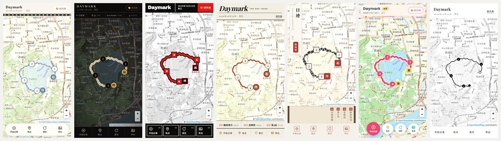
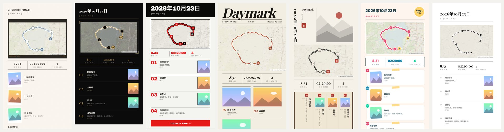

# Daymark

一天旅游打卡网页：边走边记录路线，在途经的地方钉下地点、照片和一句话，最后导出一张带主题风格的打卡图。

**在线使用：<https://lunar-milla.github.io/Daymark/>**（手机浏览器打开，可“添加到主屏幕”当作 App 使用）





## 功能

- **记录路线**：点「开始记录」后用 GPS 持续记录轨迹，显示用时和里程，可暂停 / 继续；再点一次「结束记录」停止。精度差或原地漂移的点会自动丢弃。
- **添加地点**：点「地点」再点地图放置编号标记，可附照片（自动压缩）、名称（30 字内）和一段记录（140 字内）；标记可拖动，点击可编辑或删除。
- **切换风格**：点「换风格」打开主题画廊，按分类筛选，点一下立即切换，可一键撤销。切换不会影响路线和地点。
- **导出打卡图**：生成宽 1080 的 PNG，包含路线地图、里程 / 用时 / 地点数和地点列表；日期与装饰语可以在预览中直接改。勾选「纯路线模式」可只保留轨迹、不带底图。
- **清空**：可清空全部，或只清路线、保留地点。

## 使用须知

- **数据只保存在你自己的浏览器里**：路线和文字存在 localStorage，照片存在 IndexedDB，不会上传到任何服务器。清除浏览器网站数据、或换手机 / 换浏览器后，记录不会跟过去。
- **定位需要 HTTPS 和定位权限**：请用上面的在线地址或其他 HTTPS 地址打开；直接双击本地 `index.html` 时，部分浏览器会拒绝定位。
- **记录时请保持页面在前台**：手机锁屏或切到后台后，浏览器通常会暂停定位。刷新页面后已记录的路线会保留，但进行中的记录会停止，需要重新开始。
- 需要联网加载地图瓦片、字体和两个脚本库（见文末）；离线时地图不可用，界面仍可打开。

## 主题

| 主题 | id | 分类 | 顶栏 / 工具栏 / 弹窗 / 状态条 / 目录 | 特点 |
| --- | --- | --- | --- | --- |
| 奶油胶片 | `cream` | 复古 | bar / pill / sheet / – / – | 胶片齿孔边、拍立得相纸叠层、导出地图带胶片框与片边字 |
| 黑金轻奢 | `blackgold` | 夜间 | bar / dock / sheet / strip / – | 夜间仪表盘：紧凑顶栏、常驻状态条、金色细线分区、导出带角标框 |
| 瑞士粗野主义 | `brutalist` | 设计 | split / blocks / dialog / – / – | 分格顶栏、01–04 编号方块按钮、12 栏网格、大号红色编号列表 |
| 星期日杂志海报 | `magazine` | 设计 | masthead / dock / sheet / – / strip | 刊头式斜体大标题、编辑式地点目录、导出为杂志封面（满版地图 + 期号 + 双栏目录） |
| 新中式水墨 | `ink` | 东方 | tag / dock / sheet / – / strip | 竖排题签“日迹”、朱印按钮、手卷式地点目录（竖排、由右向左）、飞白墨线 |
| 插画趣味风 | `playful` | 趣味 | float / bubbles / dialog / – / – | 悬浮圆角顶栏、漂浮圆钮、彩色贴纸、胶带卡片 |
| 极简主义 | `minimal` | 设计 | bar / text / sheet / – / – | 高留白、纯文字工具栏、下划线输入框；地图标记简化为编号小点、空心起点环与实心终点 |

后续计划新增岛屿手账、旷野探索、冒险图鉴、星糖日记、像素闯关、猎人档案、幻想旅程、怪盗拼贴等方向，进度见 [DEVELOPMENT_PLAN.md](DEVELOPMENT_PLAN.md)。这些方向借鉴游戏作品的气质，但界面、图形和文案都是原创的。

## 项目结构

```
index.html            整个应用（HTML + CSS + JS，无需构建，GitHub Pages 直接发布）
docs/                 README 用的预览图
tools/qa-shots.mjs    批量验收截图脚本（开发用，不参与发布）
DEVELOPMENT_PLAN.md   UI 与主题开发计划和进度
```

`index.html` 内部按区块组织，搜索 `/* ====` 可以快速跳转：基础变量 → 顶栏 / 画廊 / 地图 / 工具栏 / 弹窗 → **布局变体** → **主题区块**（每款主题的专属样式和导出卡片样式）→ 脚本（工具函数、存储、**主题配置 `THEMES`**、地图、记录、地点、导出、验收）。

## 本地开发

不需要安装依赖，用任意静态服务器打开即可（用 `localhost` 才能测试定位）：

```bash
python3 -m http.server 8000
# 浏览器打开 http://localhost:8000
```

### 验收模式

在地址后加参数，用内置的示例数据渲染页面，**不会读写你的真实记录**：

```
index.html?qa=<场景>&theme=<主题id>
```

| 场景 | 内容 |
| --- | --- |
| `full` | 路线 + 4 个地点，其中 3 个带横 / 竖 / 方三种比例的照片 |
| `long` | 30 字长地点名、满 140 字记录、无空格英文名 |
| `nophoto` / `noroute` / `empty` | 无照片 / 无路线 / 全空 |
| `recording` | 记录中状态 |
| `pin` / `pinphoto` | 打开地点编辑弹窗（长文本 / 有照片） |
| `clear` / `gallery` | 打开清空确认 / 主题画廊 |
| `export` / `exportroute` | 打开导出预览（地图模式 / 纯路线模式） |

还可以加 `topbar=` `toolbar=` `modal=` `status=` `list=` 强制套用某种布局变体来预览，加 `nobadge` 隐藏左下角的验收角标。验收模式会自动检查所有主题的配置（字段、布局取值、文字与背景对比度）和旧存档兼容性，结果显示在角标上，并输出到控制台（`window.__daymarkQA`）。

### 批量截图

一次截下“主题 × 场景 × 屏幕尺寸”的所有组合，并生成一张总览页：

```bash
cd tools
npm install
npx playwright install chromium
node qa-shots.mjs                                   # 全部主题、全部场景、phone/narrow/wide
node qa-shots.mjs --themes ink,playful --scenes full,export --viewports phone,landscape
```

截图保存在 `qa-shots/`（已加入 `.gitignore`），打开 `qa-shots/index.html` 查看。页面报错或主题配置有 error 时脚本以非 0 退出。

## 新增或修改主题

主题由**配置 + 布局变体**组成，大部分工作是在 `THEMES` 里写配置；只需写和默认值（`THEME_DEFAULTS`）不同的字段。

1. **写配置**：在 `THEMES` 数组里加一项。

   ```js
   {id:"island",name:"岛屿手账",category:"手账",desc:"便签与物件式工具栏",
    palette:{bg:"#F7F1E3",fg:"#2F3B34",muted:"#6F7A70",accent:"#2E8B7A",panel:"#FFFDF6",line:"rgba(47,59,52,.14)"},
    typography:{display:'"Fraunces","Noto Serif SC",serif',body:'"Noto Sans SC",system-ui,sans-serif'},
    shape:{radius:"18px",control:"14px"},
    layout:{topbar:"float",toolbar:"pill",modal:"dialog",status:"none",list:"none"},
    map:{tileOpacity:.3,tileFilter:"sepia(.2) saturate(.8)",
      route:{color:"#2E8B7A",casing:"#FFFFFF",weight:7,casingW:14},
      marker:{pin:{bg:"#FFFDF6",fg:"#2E8B7A",border:"2px solid #2E8B7A"},se:{bg:"#2E8B7A",fg:"#FFFFFF"}}},
    card:{cls:"card-island",deco:"island days"},
    motion:{dur:".3s"}}
   ```

   | 维度 | 管什么 |
   | --- | --- |
   | `palette` | 背景、文字、强调色、顶栏色、面板、分隔线、图标色 |
   | `typography` | 标题 / 正文 / 数字字体，标题字距 |
   | `shape` | 面板圆角、按钮圆角、胶囊圆角、顶栏下边线 |
   | `layout` | 选用哪种布局变体（见下表） |
   | `map` | 瓦片透明度与滤镜、路线样式（含 `ink` 水墨笔触）、起终点与地点标记的尺寸 / 颜色 / 形状 |
   | `card` | 导出卡片的 CSS 类、头部样式（`rule` / `block` / `ink` / `cover`）、装饰语、胶带 / 颗粒 / 底部横幅 / 地图片边字、竖排文字（`vertical`） |
   | `motion` | 动画时长与缓动 |

2. **选布局**：优先组合已有变体，新主题之间的差异应主要来自排布，而不只是换颜色。

   | 维度 | 可选值 |
   | --- | --- |
   | `topbar` | `bar` 整条 · `float` 悬浮卡片 · `split` 标题 / 日期 / 按钮分格 · `masthead` 刊头（大标题独占一行）· `tag` 竖排题签（悬浮在地图左上角） |
   | `toolbar` | `dock` 底部整条 · `pill` 悬浮胶囊 · `blocks` 硬边方块 · `bubbles` 独立漂浮圆钮 · `text` 纯文字按钮 |
   | `modal` | `sheet` 底部弹出 · `dialog` 居中卡片（宽屏一律居中） |
   | `status` | `none` · `strip` 顶栏下常驻里程 / 用时 / 地点数 |
   | `list` | `none` · `strip` 地图下方的地点目录，点条目定位到该地点 |

   如果现有变体都不合适，就在 CSS「布局变体」区块和 `LAYOUTS` 里新增一个，这样后续主题也能复用。

3. **写专属样式**：配置表达不了的细节（齿孔、贴纸、编号等），写在 CSS「主题区块」里，用 `body[data-theme="你的id"]` 开头；导出卡片样式写成 `.card-xxx` 规则。起点 / 终点标记分别带 `.is-start` / `.is-end`，导出卡片里地点编号 `.ec-no` 默认隐藏，可按需显示。

4. **验收**：运行 `node tools/qa-shots.mjs --themes 你的id`，逐项检查页面布局、路线与标记、所有弹窗、记录状态和导出 PNG，并确认主题检查没有 error。

注意事项：

- **主题 id 发布后不要改**：用户存档里保存的是 id。确实要改名时，在 `THEME_ALIASES` 里登记 `旧id → 新id`。
- **导出卡片里别用 `box-shadow` 做圆角卡片的阴影**：html2canvas 会把它画成灰色实块，用浅色边框代替。
- **导出卡片里有竖排文字时设 `card.vertical:true`**：html2canvas 不会把横排标点转成竖排字形，开启后会自动换成竖排标点。数字时间等短串建议用 `writing-mode:horizontal-tb` 单独横排。
- 导出地图的尺寸取自卡片 `.ec-map-in` 内层，主题可以随意给 `.ec-map` 加边框、内边距做外框，不影响标记对位。

## 第三方组件与许可

| 组件 | 用途 | 许可 |
| --- | --- | --- |
| [Leaflet](https://leafletjs.com/) 1.9.4 | 地图 | BSD-2-Clause |
| [html2canvas](https://html2canvas.hertzen.com/) 1.4.1 | 把导出卡片渲染成 PNG | MIT |
| [OpenStreetMap](https://www.openstreetmap.org/copyright) 瓦片 | 地图底图 | 数据 © OpenStreetMap contributors，ODbL；使用须遵守 [瓦片使用政策](https://operations.osmfoundation.org/policies/tiles/) |
| Google Fonts：Fraunces、Noto Serif SC、Noto Sans SC、Courier Prime、Cormorant Garamond、Archivo Black、Inter Tight、Inter、Playfair Display、Poppins、ZCOOL KuaiLe | 界面与导出字体 | SIL Open Font License 1.1 |
| [Playwright](https://playwright.dev/)（仅开发） | 批量验收截图 | Apache-2.0 |

主题图形（齿孔、贴纸、印章、水墨山形等）都用 CSS / SVG 原创绘制，没有引用外部素材。新增代码或素材时，请在上表补充来源、版本和许可。

## 许可

本项目代码以 [MIT License](LICENSE) 发布。地图数据、字体和第三方库遵循各自的许可（见上表）；导出的打卡图中的地图底图须保留 “© OpenStreetMap contributors” 署名。

## 已知限制

- 刷新页面后，进行中的记录不会自动恢复。
- 页面会一次加载全部主题字体，首次打开在慢网络下偏慢。
- 导出底图需要瓦片服务器允许跨域；不允许时会自动退回整块截图，这时底图不带主题滤镜。

更多计划和进度见 [DEVELOPMENT_PLAN.md](DEVELOPMENT_PLAN.md)。
